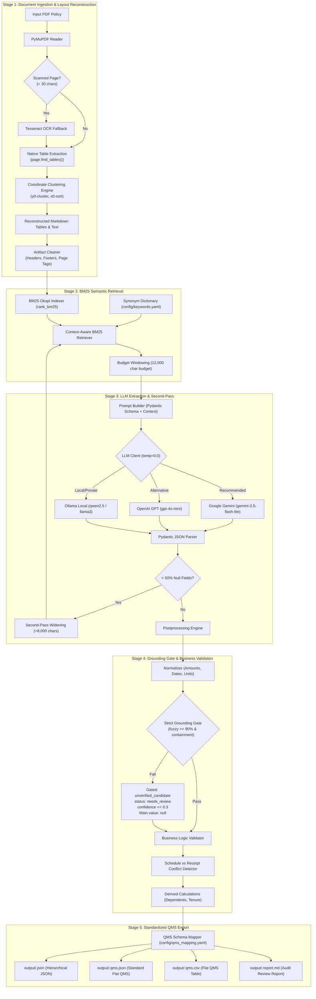

# GMC Insurance Policy Extractor

A zero-template, layout-aware AI extraction system designed to parse complex Indian **Group Medical Cover (GMC)** insurance policy documents (schedules, endorsements, terms, and member annexures) into standardized **Quote Management System (QMS)** tabular formats with verbatim quote grounding and mathematical consistency.

---

## Table of Contents
1. [Installation Guide](#1-installation-guide)
2. [How to Run the Application](#2-how-to-run-the-application)
3. [System Architecture](#3-system-architecture)
4. [Technology Stack, Libraries & Frameworks](#4-technology-stack-libraries--frameworks)
5. [Core Capabilities](#5-core-capabilities)
6. [How the Pipeline Works](#6-how-the-pipeline-works)
7. [REST API Specification](#7-rest-api-specification)
8. [CLI Command Reference](#8-cli-command-reference)
9. [Interactive React Dashboard](#9-interactive-react-dashboard)
10. [Directory Structure](#10-directory-structure)

---

## 1. Installation Guide

### Prerequisites
- **Python 3.10+** (Python 3.11 or 3.12 recommended)
- **Git** installed on your system
- **Google Gemini API Key** (or OpenAI API key / local Ollama instance)
- *(Optional)* [Tesseract OCR](https://github.com/UB-Mannheim/tesseract/wiki) (only required if processing scanned/image-only PDFs)

---

### Step-by-Step Installation

#### Step 1: Clone the Repository
```bash
git clone https://github.com/Shivasharma12/GMC.git
cd GMC
```

#### Step 2: Create a Virtual Environment
It is recommended to use an isolated Python virtual environment.

- **On Windows (PowerShell or Command Prompt):**
  ```powershell
  python -m venv venv
  .\venv\Scripts\activate
  ```

- **On macOS / Linux:**
  ```bash
  python3 -m venv venv
  source venv/bin/activate
  ```

#### Step 3: Install Required Dependencies
Install all pinned dependencies via `pip`:
```bash
pip install -r requirements.txt
```

#### Step 4: Configure Environment Variables (`.env`)
Create a `.env` file in the root directory by copying `.env.example`:
```bash
cp .env.example .env
```
Open `.env` in any text editor and add your API credentials:
```env
# Primary LLM Provider: gemini, openai, or ollama
LLM_PROVIDER=gemini

# Google Gemini Settings (Free Tier / Paid)
GEMINI_API_KEY=your_actual_gemini_api_key_here
GEMINI_MODEL=gemini-3.5-flash-lite

# (Optional) OpenAI Settings
OPENAI_API_KEY=your_openai_api_key_here
OPENAI_MODEL=gpt-4o-mini

# (Optional) Ollama Local Server Settings
OLLAMA_BASE_URL=http://localhost:11434
OLLAMA_MODEL=qwen2.5:7b

# Pipeline Settings
CACHE_DIR=.cache
LOG_LEVEL=INFO
```

---

## 2. How to Run the Application

You can run the application in two ways: via the **Interactive Web Dashboard** (recommended) or directly via the **Command Line Interface (CLI)**.

---

### Method A: Interactive Web Dashboard (Recommended)

Start the unified FastAPI server and pre-compiled React dashboard:

```bash
# Launch server on port 8000
python main.py serve --port 8000
```
*(Alternative direct launch: `python server.py --port 8000`)*

1. Open your browser and navigate to:
   ```
   http://127.0.0.1:8000
   ```
2. **Select or Upload a Policy**:
   - Pick an existing sample policy from the dropdown (e.g. `1.Policy Copy.pdf`, `Niva_Bupa_GMC_Renewal.pdf`, `GHI_Policy.pdf`).
   - Or click **Upload** to process any new GMC PDF document (up to 30MB).
3. **Run Extraction**:
   - Select your preferred engine (Google Gemini, OpenAI GPT, or Ollama Local).
   - Click **Start Extraction**. The pipeline runs retrieval, LLM extraction, normalization, and grounding validation in 5–15 seconds.
4. **Inspect Policy Intelligence**:
   - **Executive Overview**: High-level card metrics (Insurer, Policy Number, Period, Lives, floater limits, and premium summary).
   - **Coverage & Benefits Matrix**: View all 58 benefits with status badges, numerical caps, conditions, and verbatim evidence quotes.
   - **Grounding Audit**: Verify that each extracted number appears in the PDF text with $\ge 90\%$ fuzzy match.
   - **Side-by-Side PDF Viewer**: View the source document and jump directly to cited pages.
5. **Export & Download Data**:
   - Click **Export Data** in the top header to download:
     - 📥 **QMS CSV** (`.qms.csv`) — flat spreadsheet table ready for underwriting.
     - 📄 **QMS JSON** (`.qms.json`) — standard Quote Management System JSON array.
     - 🗂️ **Full JSON** (`.json`) — complete hierarchical nested schema.
     - 📝 **Audit Report** (`.report.md`) — markdown review report.

---

### Method B: Command Line Interface (CLI)

The CLI supports single file processing, batch folder extraction, and structural diagnostics:

#### 1. Extract a Single Policy PDF
```bash
python main.py run "samples/1.Policy Copy.pdf"
```
Outputs are automatically written to `output/`:
- `output/1.Policy Copy.json` (Hierarchical JSON)
- `output/1.Policy Copy.qms.json` (Flat QMS JSON)
- `output/1.Policy Copy.qms.csv` (QMS CSV)
- `output/1.Policy Copy.report.md` (Markdown report)

#### 2. Run Extraction Bypassing Cache
Force a fresh run without using cached LLM responses:
```bash
python main.py run "samples/Niva_Bupa_GMC_Renewal.pdf" --no-cache
```

#### 3. Run with Specific Provider or Model Override
```bash
python main.py run "samples/GHI_Policy.pdf" --provider gemini --model gemini-3.5-flash-lite --no-cache
```

#### 4. Batch Process an Entire Directory of PDFs
```bash
python main.py run-all "samples/"
```

#### 5. Inspect PDF Structure Without Calling LLM
Quickly check page count, scanned status, and structural ALL-CAPS section headings:
```bash
python main.py inspect "samples/1.Policy Copy.pdf"
```

---

## 3. System Architecture

The pipeline processes policies through a 5-stage hybrid architecture combining native C-level PDF parsing, layout-preserving table reconstruction, synonym-driven BM25 retrieval, schema-enforced LLM inference, and an automated Grounding Gate.



---

## 4. Technology Stack, Libraries & Frameworks

| Layer | Library / Framework | Version | Role & Justification |
| :--- | :--- | :--- | :--- |
| **PDF Extraction** | `pymupdf` (fitz) | `1.24.5` | Fast C-native text extraction, word bounding boxes (`x0, y0, x1, y1`), and table detection (`page.find_tables()`). |
| **Table Extraction** | `pdfplumber` | `0.11.4` | Fallback vector-line table extraction for complex bordered annexures. |
| **OCR Engine** | `pytesseract` + `Pillow` | `0.3.13` / `10.4.0+` | Rasterizes scanned/image-only pages into PIL images and extracts text via Tesseract OCR when native text character count $< 30$. |
| **Information Retrieval**| `rank-bm25` | `0.2.2` | Fast BM25 Okapi search algorithm over document pages, preventing LLM token waste on 50–100 page policies. |
| **Fuzzy Matching** | `rapidfuzz` | `3.9.7` | C++ accelerated Levenshtein string matching for the Grounding Gate ($\ge 90\%$ match) and section header detection. |
| **Schema Validation** | `pydantic` | `2.8.2` | Strict JSON schema definitions, automatic type coercion, field constraints, and hierarchical validation. |
| **LLM Provider (Default)**| `google-genai` | `1.16.1` | Official Google GenAI SDK for Gemini 2.0 / 3.5 Flash Lite (`gemini-3.5-flash-lite`) supporting structured JSON schema enforcement. |
| **HTTP Clients** | `httpx` & `requests` | `0.28.1` / `2.32.3+` | Async and sync HTTP communications with OpenAI, Ollama, and Gemini backends with automated IPv6 `NO_PROXY` sanitization. |
| **Resilience & Retries** | `tenacity` | `9.0.0` | Exponential backoff, jitter, and rate-limit retry handling for external API calls. |
| **Backend Framework** | `fastapi` | `0.115.0+` | Asynchronous high-performance REST API with automated OpenAPI documentation and direct file streaming. |
| **ASGI Server** | `uvicorn` | `0.30.0+` | ASGI production server hosting FastAPI and serving the static React build artifacts. |
| **CLI Framework** | `typer` + `click` | `0.12.5` / `8.1.7` | Powers the `main.py` CLI interface (`run`, `run-all`, `inspect`, `serve`). |
| **Terminal Formatting**| `rich` | `13.8.1` | Colorized progress bars, diagnostic trees, summary tables, and logging formatters. |
| **Configuration** | `python-dotenv` & `PyYAML` | `1.0.1` / `6.0.2` | Multi-environment `.env` parsing and YAML configuration files for keywords and QMS mappings. |
| **Frontend UI** | `React` 18 | `18.3.1` | Modern component-based web UI with tab routing, state management, and side-by-side PDF viewer. |
| **Build Tool** | `Vite` | `8.3.5` | Fast frontend compilation and asset bundling into `dashboard/dist/`. |
| **Icons** | `lucide-react` | `0.460.0` | Iconography for dashboard status badges, action dropdowns, and cards. |

---

## 5. Core Capabilities

### A. Zero-Template & Insurer-Agnostic
- **No hardcoded insurer names, no hardcoded page numbers, and no company-specific templates.**
- Uses a synonym dictionary (`config/keywords.yaml`) covering Indian insurance terminology:
  - *Lakh / Lac / Cr*, *AYUSH*, *Domiciliary*, *PED*, *TPA*, *Corporate Buffer*, *Day Care Procedures*.
  - UK/US spelling variants (*hospitalisation* / *hospitalization*, *pre-existing* / *preexisting*).
- Parses policies from any carrier (Care Health, Niva Bupa, National Insurance, Star Health, ICICI Lombard, etc.).

### B. Layout-Aware Table & Word Coordinate Reconstruction
- Group insurance schedules often separate labels from values horizontally across columns. Raw PDF text extraction frequently dumps all left-hand labels first and right-hand values second.
- GMC Extractor solves this with a two-tiered layout engine in `gmc_extractor/pdf/tables.py`:
  1. **Native PyMuPDF Tables**: `page.find_tables()` discovers explicit cell boundaries.
  2. **Word Bounding Box Clustering**: `y0` clustering with $3.5\,\text{pt}$ vertical tolerance groups text into horizontal lines; words are sorted along $x_0$ and column gaps ($> 15\,\text{pt}$) are translated into markdown table columns (`| Label | Value |`).

### C. Strict Grounding Gate (Hallucination Prevention)
- Every candidate value produced by an LLM passes through `gmc_extractor/postprocess/grounding.py`:
  1. **Verbatim Quote Match**: The cited evidence quote must exist in the PDF page text with a RapidFuzz score $\ge 90\%$.
  2. **Value Containment**: The extracted number, currency amount, percentage, or day count must physically appear inside both the evidence quote and the source page text.
- If grounding fails:
  - The value is **rejected from the main QMS column** (set to `None`).
  - Stored inside `unverified_candidate` for human audit.
  - Status is set to `needs_review` with confidence $\le 0.30$.
  - A warning is recorded in the audit report.

### D. 58+ Standardized Benefits Extracted
Extracts over 58 fields across 10 functional groups:
1. **Identity**: Insurer name, TPA name (with in-house claims servicing detection).
2. **Policy Details**: Policy number, inception/start/end dates, tenure in months, gross and net premium, GST, sum insured tiers, total sum insured.
3. **Demographics**: Number of employees, spouses, children, parents, stated total lives, derived dependents count, census mismatch flags.
4. **Room & Hospitalization**: Room rent (normal vs ICU, daily limits, % of SI), pre-hospitalization days, post-hospitalization days.
5. **Maternity**: Normal and C-Section limits (metro vs non-metro), 9-month waiting waiver, baby day 1 cover, newborn vaccination.
6. **Waiting Periods**: 30-day initial waiting, 1st year specified disease waiting, 2nd year waiting, Pre-Existing Diseases (PED) waiting period waivers.
7. **Other Benefits A**: OPD consultation limits, teleconsultation, pharmacy discounts, domiciliary hospitalization, annual health checkup, modern treatments.
8. **Other Benefits B**: Bariatric surgery, psychiatric treatment, AYUSH coverage, LGBTQ+ and live-in partner definitions, organ donor expenses.
9. **Infertility & Ambulance**: Infertility treatment sub-limits, surrogacy coverage status, road ambulance per-hospitalization cap, air ambulance.
10. **Buffer & Waivers**: Corporate floater amount, eligibility conditions, disease-specific capping list, unified waiver conditions list, procedure-wise co-pay caps.

---

## 6. How the Pipeline Works

1. **Stage 1: Document Ingestion & Text Normalization** (`gmc_extractor/pdf/`)
   - Reads the PDF with PyMuPDF. If native text character count $< 30$, activates Tesseract OCR.
   - Extracts tables and applies coordinate clustering to reconstruct columns.
   - Strips running headers, footers, and page numbers, and detects ALL-CAPS structural section headings.

2. **Stage 2: BM25 Tokenization & Retrieval** (`gmc_extractor/retrieval/`)
   - Builds an in-memory BM25 Okapi index over all cleaned pages.
   - Queries the index using expanded synonym keywords for the target field group.
   - Retrieves the top-$k$ relevant pages plus their immediate adjacent context pages up to a character budget ($12,000$ characters).

3. **Stage 3: LLM Inference & Second-Pass Widening** (`gmc_extractor/prompt/`, `llm/`)
   - Builds a prompt with strict Pydantic JSON schemas and few-shot examples.
   - Enforces `temperature=0.0` for deterministic extraction.
   - If $> 50\%$ of the fields in a group are returned null, automatically initiates a **Second-Pass Widening** with an expanded character budget ($20,000$ characters).

4. **Stage 4: Normalization & Grounding Gate** (`gmc_extractor/postprocess/`)
   - Normalizes currency (`2,50,000` $\rightarrow$ `250000`) and dates (`YYYY-MM-DD`).
   - Handles "Not Covered": If Corporate Floater is "Not Covered" with limit "NA", sets status to `not_covered` and amount to `None`.
   - Parses the complete list of procedure caps (up to 16 procedures) for disease capping.
   - Runs the Grounding Gate to verify quotes and numerical containment.

5. **Stage 5: Standardization & QMS Mapping** (`gmc_extractor/export/`)
   - Maps internal paths to standard QMS rows (`POL_SI_TIERS`, `ROOM_RENT`, `MAT_NORMAL_METRO`, `BUF_AMOUNT`, etc.) using `config/qms_mapping.yaml`.
   - Generates four output files in `output/`:
     - `<stem>.json`: Complete hierarchical JSON output.
     - `<stem>.qms.json`: Array of standardized QMS field objects.
     - `<stem>.qms.csv`: Flat CSV ready for import into underwriting tools.
     - `<stem>.report.md`: Markdown audit report highlighting warnings and reviews.

---

## 7. REST API Specification

The FastAPI server in `server.py` hosts the backend API and serves the compiled React dashboard at `http://127.0.0.1:8000`.

### Endpoints

| Method | Endpoint | Description |
| :--- | :--- | :--- |
| `GET` | `/api/health` | Returns server health status, active provider, and available models. |
| `GET` | `/api/policies` | Lists all extracted policies in `output/` with summary metrics. |
| `GET` | `/api/policies/{policy_id}` | Retrieves full policy details (hierarchical JSON, QMS JSON, CSV text, and audit report). |
| `POST` | `/api/extract` | Runs extraction on an uploaded PDF (`file`) or existing sample (`existing_path`). Parameters: `provider`, `model`, `no_cache`. |
| `GET` | `/api/policies/{policy_id}/export/{export_type}` | Triggers direct browser file download for `csv`, `qms`, `json`, or `report`. |
| `GET` | `/api/pdf/{filename}` | Streams the source PDF for in-browser side-by-side inspection. |
| `GET` | `/api/samples` | Lists available sample and uploaded PDFs. |

---

## 8. CLI Command Reference

The CLI in `main.py` is built with `typer`:

```bash
# 1. Run extraction on a single PDF
python main.py run samples/1.Policy Copy.pdf

# 2. Run extraction bypassing cache with a specific provider
python main.py run samples/GHI_Policy.pdf --provider gemini --no-cache

# 3. Process an entire folder of PDF policies
python main.py run-all samples/

# 4. Inspect PDF structure (page count, scanned pages, section headings)
python main.py inspect samples/Niva_Bupa_GMC_Renewal.pdf

# 5. Start the Interactive React Dashboard & REST API
python main.py serve --port 8000
```

---

## 9. Interactive React Dashboard

The dashboard provides an enterprise visual interface:

- **Executive Overview**: High-level card metrics (Insurer, Policy Number, Inception/Expiry Dates, Lives, Corporate Floater, Premium, GST, and Census Mismatch alerts).
- **Coverage & Benefits Matrix**: Tabular breakdown of all 58 benefits grouped by category, showing status badges, limits, percentages, conditions, and verbatim evidence.
- **Grounding & Validation Audit**: Inspection tool detailing verified grounded fields, fields requiring human review, and conflict logs.
- **Original PDF Document Viewer**: Embedded PDF viewer allowing users to jump directly to cited source pages.
- **QMS Schema & Raw Exports**: Interactive searchable table of the QMS CSV, with copy and download utilities for CSV, QMS JSON, and Markdown reports.
- **Direct Export Menu**: Top-header dropdown providing 1-click downloads for QMS CSV, QMS JSON, Full JSON, and Audit Reports.
- **Re-Extract Utility**: Pre-loads the active document path and allows 1-click re-processing with cache bypass.

---

## 10. Directory Structure

```text
GMC/
├── config/
│   ├── keywords.yaml         # Indian insurance synonym dictionary & search terms
│   └── qms_mapping.yaml      # Mapping from internal Pydantic paths to flat QMS keys
├── dashboard/                # Modern React 18 + Vite Web Dashboard
│   ├── dist/                 # Compiled production distribution served by FastAPI
│   └── src/                  # Source React components (Header, Overview, Matrix, Audit)
├── gmc_extractor/            # Core Python package
│   ├── export/               # QMS mapper and JSON/CSV/Markdown writers
│   ├── llm/                  # Gemini, OpenAI, and Ollama client implementations
│   ├── pdf/                  # PyMuPDF reader, table coordinate clustering, OCR
│   ├── postprocess/          # Normalizer, Grounding Gate, validator, confidence scorer
│   ├── prompt/               # Prompt construction and group-specific schemas
│   ├── retrieval/            # BM25 indexer and context window retriever
│   ├── schema/               # Pydantic v2 data models
│   ├── pipeline.py           # Master execution pipeline
│   └── runner.py             # Group extraction execution and second-pass logic
├── output/                   # Generated extraction files (.csv, .json, .md)
├── samples/                  # Official sample policy PDFs
├── uploads/                  # User-uploaded PDFs
├── venv/                     # Python 3.12 virtual environment
├── main.py                   # Typer CLI entrypoint
├── README.md                 # Single comprehensive project documentation & guide
├── requirements.txt          # Python dependencies
└── server.py                 # FastAPI backend server
```
