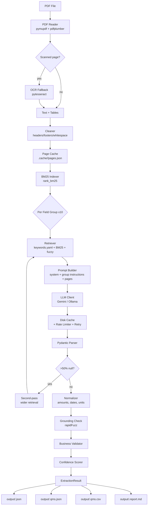

# GMC Extractor

A production-quality Python pipeline that reads **Group Medical Cover (GMC)** insurance policy PDFs from Indian insurers and produces structured JSON output mapped to a QMS schema — with **no hardcoded templates, no insurer-specific logic**, and full graceful degradation.



---

## Technologies

| Layer | Library | Why |
|---|---|---|
| PDF text | `pymupdf` (fitz) | Fast, layout-aware, renders pages for OCR |
| PDF tables | `pdfplumber` | Best-in-class table detection |
| OCR fallback | `pytesseract` + `Pillow` | Handles scanned pages (optional) |
| Retrieval | `rank_bm25` + `rapidfuzz` | Keyword + fuzzy matching over pages |
| Schema | `pydantic` v2 | Strict JSON validation + serialization |
| LLM – Gemini | `google-genai` | Gemini Flash-Lite free tier (`gemini-3.5-flash-lite`) |
| LLM – OpenAI | `requests` (native) | OpenAI GPT-4o-mini / GPT-4o |
| LLM – Ollama | `requests` → Ollama | Local or remote Ollama server with API key |
| CLI | `typer` + `rich` | Beautiful progress + tables |
| Config | `python-dotenv` + `PyYAML` | Env + YAML driven, no hardcoding |

> **Free-tier note**: By default the Gemini free tier is used (`gemini-3.5-flash-lite`). Data sent to the free tier **may** be used by Google to improve their models. For sensitive documents, use Ollama (local) or a paid Gemini/OpenAI plan.

---

## Setup

### 1. Clone and create virtualenv

```bash
git clone <repo>
cd gmc-extractor
python -m venv venv
# Windows:
venv\Scripts\activate
# macOS/Linux:
source venv/bin/activate
```

### 2. Install dependencies

```bash
pip install -r requirements.txt
```

### 3. (Optional) Install Tesseract for scanned PDFs

- **Windows**: download from https://github.com/UB-Mannheim/tesseract/wiki, add to PATH
- **Ubuntu**: `sudo apt-get install tesseract-ocr`
- **macOS**: `brew install tesseract`

If Tesseract is not installed, scanned pages will produce a warning and be skipped.

### 4. Configure environment

```bash
cp .env.example .env
# Edit .env — add your GEMINI_API_KEY or set LLM_PROVIDER=ollama
```

---

## Running

```bash
# Process a single PDF
python main.py run samples/policy.pdf

# Process all PDFs in a folder
python main.py run-all samples/

# Debug / inspect a PDF
python main.py inspect samples/policy.pdf

# CLI options
python main.py run samples/policy.pdf --provider gemini --no-cache --verbose
python main.py run-all samples/ --max-requests 30
```

---

## CLI Options

| Option | Default | Description |
|---|---|---|
| `--provider` | from `.env` | `gemini`, `openai`, `ollama`, or `mock` |
| `--model` | from `.env` | Override model name |
| `--no-cache` | false | Bypass disk cache |
| `--max-requests` | from `.env` | Hard cap on LLM calls per run |
| `--verbose` | false | DEBUG-level logging |

---

## Outputs

| File | Description |
|---|---|
| `output/<stem>.json` | Full nested result with source pages and confidence |
| `output/<stem>.qms.json` | Flat QMS rows (key-value) |
| `output/<stem>.qms.csv` | CSV version of QMS rows |
| `output/<stem>.report.md` | Human-review report: low-confidence and not-found fields |

---

## Extraction Methodology

### Why hybrid?

1. **Layout-aware parsing**: PyMuPDF and pdfplumber preserve table structures that plain text extraction destroys. Tables carry most benefit limits.
2. **BM25 retrieval**: With 50-80 pages per PDF, sending everything to the LLM is too expensive. BM25 finds the most relevant pages per field group using the keyword synonyms in `config/keywords.yaml`.
3. **Schema-constrained LLM**: The model is given a precise JSON schema and instructed to return only what's present. Temperature 0 minimizes hallucination.
4. **Grounding checks**: Every number the LLM returns is verified to appear in the source text using fuzzy matching (rapidFuzz). Failed grounding lowers confidence but never silently drops values.
5. **Second-pass widening**: If >50% of fields in a group come back as null/not_mentioned, the retriever is re-run with wider parameters to catch sparse information.

### Adaptability (no templates)

- **Synonym-driven retrieval**: `config/keywords.yaml` lists Indian insurance terms (lakh, lac, AYUSH, domiciliary, TPA, etc.) and UK/US variants (hospitalisation/hospitalization, pre-existing/PED). No insurer names, no page numbers.
- **Annexure override rule**: The system prompt instructs the LLM that Annexures/Endorsements/Special Conditions override base policy wording.
- **Section heading detection**: Heuristic ALL-CAPS and numbered clause detection boosts pages with structural markers regardless of insurer.
- **Second-pass widening**: Ensures sparse layouts still get populated.

---

## JSON Schema

Every benefit uses the `FeatureValue` model:

```json
{
  "status": "covered | not_covered | waived_off | applied | limited | not_mentioned",
  "limit_amount": 500000,
  "limit_percent_of_si": null,
  "limit_days": null,
  "limit_text": null,
  "conditions": ["Up to 2 children", "Metro cities only"],
  "source_pages": [12, 13],
  "evidence": "Normal delivery: Rs. 50,000 in metro cities",
  "confidence": 0.91
}
```

Top-level fields:

```
ExtractionResult
├── document_info        (file, pages, scanned_pages, provider, model, timestamp)
├── identity             (insurer_name, tpa_name)
├── policy_details       (dates, tenure, premium, family_structure, si_tiers)
├── demographics         (employees, spouses, children, parents, total_lives)
└── features
    ├── room_hospitalization
    ├── maternity
    ├── waiting_periods
    ├── other_benefits_a
    ├── other_benefits_b
    ├── infertility_ambulance
    └── buffer_waiver
```

---

## QMS Mapping

`config/qms_mapping.yaml` maps internal field paths to flat QMS field names:

```yaml
features.maternity.normal_delivery_metro:
  qms_field: MAT_NORMAL_METRO
  label: "Maternity - Normal Delivery (Metro)"
```

The CSV output has columns: `qms_field`, `label`, `status`, `limit_amount`, `limit_text`, `confidence`, `source_pages`.

---

## Running Tests

```bash
pytest -v
```

Tests use a mocked LLM client so no API key is needed.

---

## Assumptions & Known Limitations

- PDFs must be machine-readable or OCR-able (Tesseract). Password-protected PDFs are not supported.
- Very low-quality scans may have poor OCR accuracy.
- Free-tier Gemini limits: 15 RPM / 1M tokens/day. The rate limiter respects `REQUESTS_PER_MINUTE`.
- The pipeline makes ~10 LLM calls per PDF. With `MAX_REQUESTS_PER_RUN=60`, up to 6 PDFs can be processed per run.
- Extremely unusual policy structures (non-standard clauses) may require adding synonyms to `config/keywords.yaml`.

---

## Future Improvements

- Fine-tuned embeddings for denser semantic retrieval
- Multi-PDF comparison / delta detection
- Web UI for reviewing low-confidence fields
- Support for Excel/CSV census files (demographics)
- Streaming output for large batches

---

## Sample Output

```json
{
  "document_info": {
    "file_name": "policy_2024.pdf",
    "total_pages": 62,
    "scanned_pages": 0,
    "provider": "gemini",
    "model": "gemini-3.5-flash-lite",
    "run_timestamp": "2024-04-26T10:30:00"
  },
  "features": {
    "maternity": {
      "nine_month_waiting_period": {
        "status": "waived_off",
        "conditions": ["Covered from day 1 for existing members"],
        "source_pages": [18],
        "evidence": "Maternity waiting period waived for existing members",
        "confidence": 0.88
      }
    }
  }
}
```
