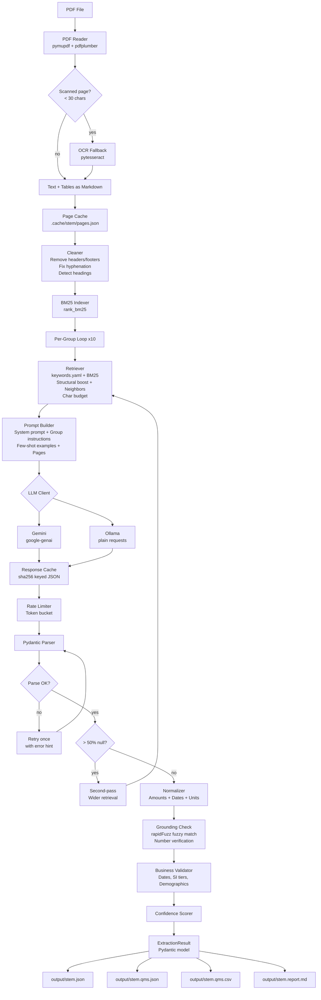
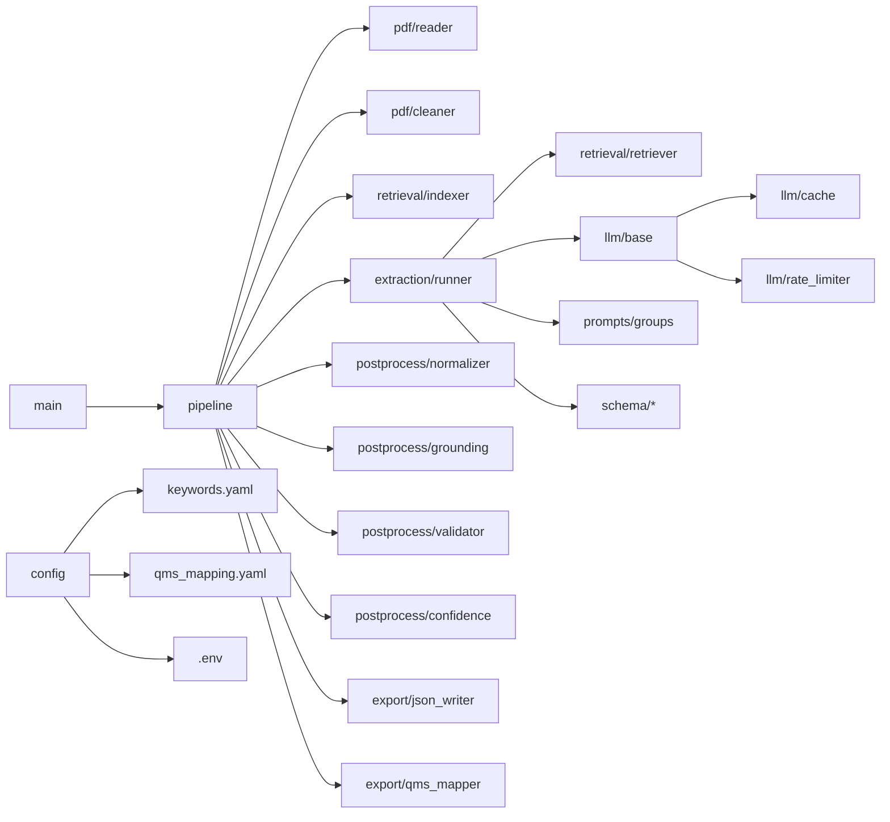

# Architecture

## System Architecture

## Module Dependency Graph

## Data Flow

1. **PDF → PageDoc list**: PyMuPDF extracts text; pdfplumber extracts tables; OCR runs on scanned pages. Each page becomes a `PageDoc` with `full_text` including `[PAGE n]` markers.

2. **PageDoc → BM25 index**: All page texts are tokenised and indexed. Structural pages (Annexure, Schedule, etc.) are flagged for boost.

3. **Group → retrieved pages**: For each of the 10 field groups, BM25 scores pages against the group's keywords+synonyms from `keywords.yaml`. Top-k pages plus neighbours are selected within a character budget.

4. **Retrieved pages → LLM prompt**: The system prompt, group-specific instructions with schema, few-shot examples, and the retrieved page texts (with `[PAGE n]` markers) are concatenated.

5. **LLM response → Pydantic model**: The JSON response is validated against the group's Pydantic model. On parse failure, a single retry with the error appended is made.

6. **Second pass**: If >50% of a group's fields are null/not_mentioned, retrieval is widened and a second LLM call is made. The results are merged, preferring non-null values.

7. **Postprocessing**: Amounts/dates/units are normalised. Evidence quotes and numeric values are verified against source text using rapidFuzz. Business rules are checked. Confidence scores are computed.

8. **Export**: Full JSON, flat QMS JSON, CSV, and a human-review Markdown report are written to `output/`.

## Key Design Decisions

| Decision | Rationale |
|---|---|
| No insurer templates | Generic keyword YAML + synonym expansion covers all layouts |
| FeatureValue for all benefits | Consistent structure enables uniform QMS mapping |
| BM25 retrieval | Free, fast, no embeddings needed, sufficient for keyword-heavy insurance docs |
| Character budget | Keeps prompts within free-tier context limits |
| Annexure override rule | GMC policies frequently modify base terms via endorsements |
| Second-pass widening | Handles sparse layouts where benefits are scattered |
| Disk cache | Avoids re-running expensive LLM calls on the same content |
| Grounding check | Catches hallucinated numbers without silently deleting them |
| Warnings (not crashes) | One bad group must not fail the whole extraction |
